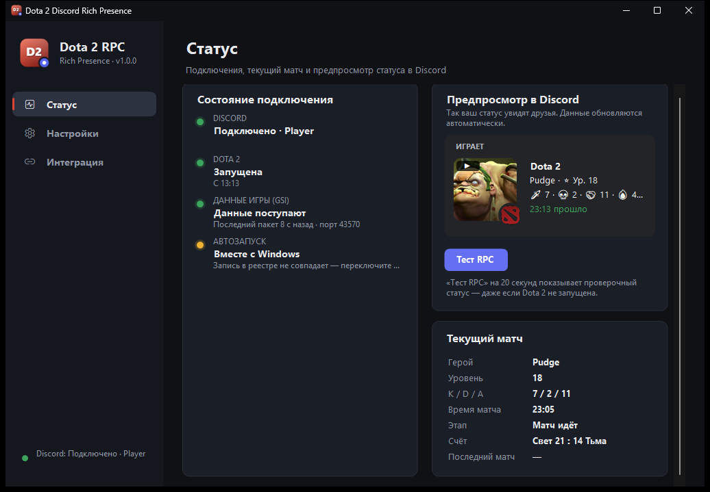
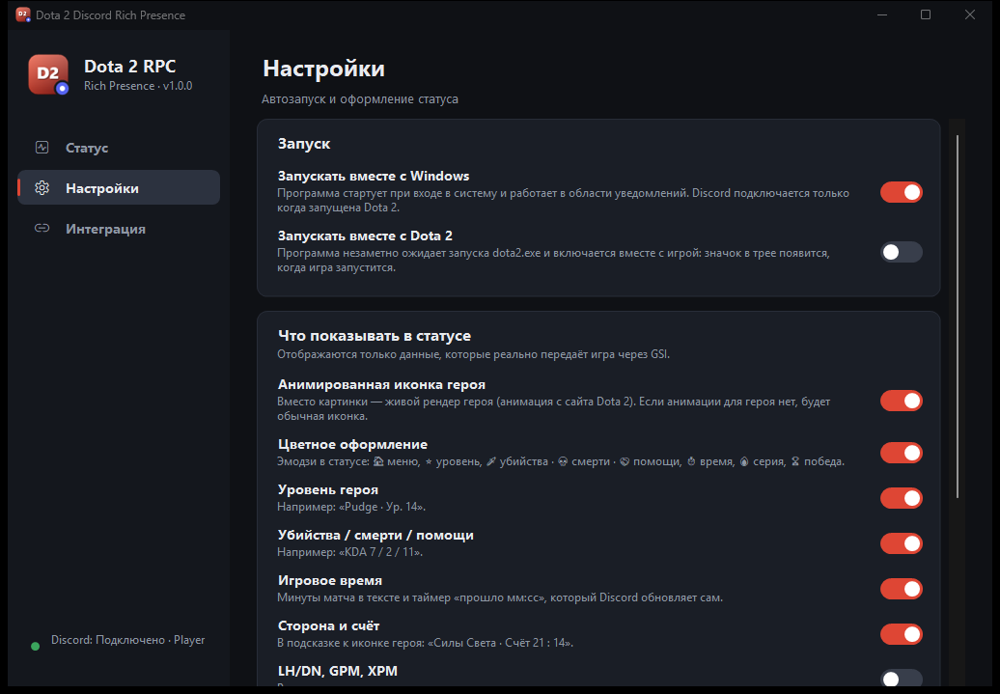

# Dota 2 Discord Rich Presence

[](https://github.com/hghoul/dota2-discord-rpc/actions/workflows/build.yml)
[](https://github.com/hghoul/dota2-discord-rpc/releases/latest)


[](LICENSE)

**[⬇ Скачать Setup.exe](https://github.com/hghoul/dota2-discord-rpc/releases/latest/download/Setup.exe)** · [все версии](https://github.com/hghoul/dota2-discord-rpc/releases)

Программа для Windows 10/11, которая показывает в профиле Discord ваш текущий матч Dota 2:

- **иконку и имя героя** (крупная картинка) и красный логотип Dota 2 (маленький значок; в главном меню — крупная картинка);
- **уровень героя** — «Pudge · Ур. 18»;
- **K/D/A** — «KDA 7 / 2 / 11»;
- **игровое время в минутах** — «23 мин» в тексте, плюс таймер «прошло мм:сс», который Discord обновляет сам;
- этапы матча: выбор героя, стратегия, подготовка (обратный отсчёт до 0:00), игра, пауза, итог «Победа/Поражение», главное меню, режим наблюдателя;
- в подсказке к иконке — сторона и счёт («Силы Света · Счёт 21 : 14»), по желанию LH/DN, GPM, XPM;
- по желанию — кнопка «Профиль на OpenDota»;
- **цветное оформление** (включено по умолчанию, отключается в настройках): эмодзи в строках статуса и 🔥 при серии из 3+ убийств;
- **анимированная иконка героя** (включено по умолчанию): живой рендер героя вместо статичной картинки.

Пример статуса во время матча:

```
Играет в Dota 2
Pudge · ⭐ Ур. 18
🗡️ 7 · 💀 2 · 🤝 11 · 🔥 4 · ⏱️ 23 мин
23:11 прошло
```

В главном меню — «🏠 В главном меню» с красным логотипом Dota 2, после матча — «🏆 Победа · матч завершён» или «💔 Поражение · матч завершён». Без цветного оформления строки выглядят как «Pudge · Ур. 18» и «KDA 7 / 2 / 11 · 23 мин».



## Быстрая установка

1. Скачайте **[Setup.exe](https://github.com/hghoul/dota2-discord-rpc/releases/latest/download/Setup.exe)** из [последнего релиза](https://github.com/hghoul/dota2-discord-rpc/releases/latest) и запустите его. Права администратора не нужны. Установщик не подписан цифровой подписью, поэтому SmartScreen может предупредить — **Подробнее → Выполнить в любом случае** (контрольная сумма SHA256 указана в описании релиза).
2. Оставьте отмеченным «Добавить параметр запуска -gamestateintegration» — установщик сам найдёт Dota 2, поставит конфигурацию игры и (с вашего согласия, закрыв и снова открыв Steam) добавит параметр запуска.
3. Запустите **приложение Discord для ПК** и Dota 2. Всё — статус появится сам. Проверить без матча можно кнопкой «Тест RPC» в окне программы.

Ничего настраивать в Discord Developer Portal не нужно: Application ID уже встроен. Подробности и решение проблем — ниже.

## Как это работает

```
Dota 2 ──(Game State Integration, HTTP POST)──► Dota2RPC.exe на 127.0.0.1:43570
                                                     │
                                                     └──(Discord IPC: \\.\pipe\discord-ipc-0, SET_ACTIVITY)──► Discord
```

- **Game State Integration (GSI)** — официальный механизм Valve. Игра сама отправляет состояние матча на локальный адрес, указанный в файле `game\dota\cfg\gamestate_integration\gamestate_integration_dota2rpc.cfg`. Программа **не читает память игры, не внедряется в процесс и не изменяет игровые файлы** (кроме этого конфига), поэтому риска блокировки VAC нет.
- **Discord Rich Presence** — через локальный IPC-канал клиента Discord (тот же протокол, что у официальной библиотеки discord-rpc). Нужно зарегистрированное приложение Discord и его **Application ID**.
- Иконки героев загружает сам Discord по ссылкам CDN Valve (`cdn.cloudflare.steamstatic.com/apps/dota2/images/dota_react/heroes/...`). Красный логотип Dota 2 — официальная иконка игры из каталога Discord (`cdn.discordapp.com/app-icons/356875988589740042/...`); её актуальный адрес программа уточняет при запуске через публичный API Discord. Загружать картинки в Developer Portal **не нужно**.

### Какие данные доступны через GSI (проверено)

| Данные | Источник GSI | Отображается |
|---|---|---|
| Герой | `hero.name` (`npc_dota_hero_pudge`) | имя (из официального списка героев Valve) и иконка |
| Уровень героя | `hero.level` | да |
| Убийства / смерти / помощи | `player.kills`, `player.deaths`, `player.assists` | да |
| Игровое время | `map.clock_time` (секунды, до 0:00 — отрицательное) | минуты + таймер Discord |
| Этап матча, пауза | `map.game_state`, `map.paused` | да |
| Победа/поражение | `map.win_team` + `player.team_name` | да |
| Счёт | `map.radiant_score`, `map.dire_score` | в подсказке |
| LH/DN, GPM, XPM | `player.last_hits`, `denies`, `gpm`, `xpm` | по желанию |

Чего GSI **не передаёт**, и программа это **не показывает и не придумывает**: ранг/медаль, режим игры (рейтинговая/турбо и т.п.), MMR. В режиме наблюдателя GSI отдаёт данные всех игроков, а не «ваши», поэтому там показывается только счёт и время. Если какое-то значение не пришло от игры (например, уровень до выбора героя), соответствующая часть статуса просто не выводится.

## Требования

- Windows 10 (1809+) или Windows 11, 64-бит.
- **Приложение Discord для ПК** (в браузерной версии Discord Rich Presence не работает).
- Dota 2 в Steam.
- Всё остальное (среда .NET 10) уже встроено в программу — отдельно ничего ставить не нужно.

---

## Шаг 1 (необязательно). Своё приложение в Discord Developer Portal

> **В готовом `Setup.exe` из релизов Application ID уже встроен — этот шаг пропустите** — установщик не спросит ID, а программа сразу будет использовать встроенный. Шаг нужен тому, кто собирает программу (один раз), или пользователю, который хочет показывать статус от имени своего приложения.

Discord показывает Rich Presence только от имени зарегистрированного приложения. Его **имя** будет написано в статусе («Играет в **Dota 2**»).

1. Откройте <https://discord.com/developers/applications> и войдите в свой аккаунт Discord.
2. Нажмите **New Application** (справа вверху).
3. В поле **Name** введите `Dota 2` (или любое другое имя — именно оно будет после «Играет в»). Отметьте согласие с условиями и нажмите **Create**.
4. Откроется страница **General Information**. Найдите поле **Application ID** и нажмите **Copy**. Это число из 18–19 цифр — оно понадобится при установке.
5. (Необязательно) Там же в **App Icon** можно загрузить иконку — она видна в некоторых местах интерфейса Discord.

> Раздел **Rich Presence → Art Assets** заполнять не нужно: картинки героев передаются ссылками на CDN Valve.
> Application ID не является секретом, но **Client Secret** и **Bot Token** никому не передавайте — программе они не нужны.

## Шаг 2. Установка

1. Запустите `Setup.exe`.
   Установщик не подписан цифровой подписью, поэтому Windows SmartScreen может показать «Система Windows защитила ваш компьютер» — нажмите **Подробнее → Выполнить в любом случае**.
2. Права администратора не нужны: программа ставится в `%LOCALAPPDATA%\Programs\Dota2RPC` для текущего пользователя.
3. На странице **Автозапуск** выберите режим:
   - **Запускать вместе с Windows** (рекомендуется) — программа стартует при входе в систему и сидит в трее. К Discord подключается только когда запущена Dota 2.
   - **Запускать вместе с Dota 2** — программа незаметно (без значка) ждёт запуска `dota2.exe`, а с запуском игры включается и показывает значок в трее.
   - **Не запускать автоматически**.
4. Оставьте включённым **«Добавить параметр запуска -gamestateintegration в Steam»** (см. шаг 3).
5. Если ID не встроен в установщик, на странице **Приложение Discord** вставьте **Application ID** из шага 1 (при встроенном ID этой страницы нет). Кнопка «Открыть портал Discord» откроет Developer Portal. Поле можно оставить пустым и заполнить позже в программе.
6. Установщик автоматически:
   - найдёт Dota 2 (реестр Steam → `libraryfolders.vdf` → `appmanifest_570.acf`) и запишет конфиг GSI;
   - настроит автозапуск;
   - при выбранной опции добавит параметр запуска (если Steam запущен — спросит разрешения закрыть его и затем запустит снова);
   - покажет итог: что сделано (✔) и что нужно сделать вручную (✖) с объяснением.

## Шаг 3. Параметр запуска `-gamestateintegration`

Valve требует этот параметр, иначе игра не отправляет данные GSI. Установщик и кнопка **«Добавить автоматически»** (вкладка «Интеграция») добавляют его сами. Steam перезаписывает настройки при выходе, поэтому для автоматического добавления Steam должен быть закрыт — программа спросит и сделает это за вас (резервная копия: `localconfig.vdf.dota2rpc.bak` рядом с исходным файлом).

Вручную: **Steam → Библиотека → правый клик по Dota 2 → Свойства → Общие → Параметры запуска** → допишите `-gamestateintegration` (через пробел к уже имеющимся параметрам).

## Шаг 4. Проверка

1. Убедитесь, что запущено **приложение Discord**.
2. Откройте программу (значок в трее или ярлык «Dota 2 Discord Rich Presence»), вкладка **«Статус»**.
3. Нажмите **«Тест RPC»** — на 20 секунд в вашем профиле Discord появится проверочный статус. Программа покажет ответ Discord: «✔ Discord подтвердил тестовый статус» или понятную причину ошибки.
4. Запустите (или перезапустите) Dota 2. На вкладке «Статус» должно стать: Dota 2 — **Запущена**, Данные игры (GSI) — **Данные поступают**, Discord — **Подключено**.
5. Предпросмотр на вкладке «Статус» показывает ровно то, что видят друзья.

В Discord должна быть включена опция **Настройки пользователя → Конфиденциальность активности → «Делиться информацией о своей активности»** (Share your detected activities with others).

---

## Окно программы



- **Статус** — подключение к Discord, состояние Dota 2 и данных игры, автозапуск; предпросмотр статуса в стиле Discord; текущий матч (герой, уровень, K/D/A, время, этап, счёт) и последний завершённый матч; кнопка «Тест RPC».
- **Настройки** — автозапуск с Windows / вместе с Dota 2 и что показывать в статусе.
- **Интеграция** — папка Dota 2 (если программа не нашла её сама), параметр запуска Steam и кнопка «Повторная настройка», если статус не появляется.

### Режим разработчика

Технические настройки по умолчанию скрыты. Их включает переключатель **Настройки → Для разработчиков → Режим разработчика**. В этом режиме дополнительно видны:

- Application ID Discord (свой ID вместо встроенного, проверка ID через Discord, ссылка на Developer Portal);
- на «Статусе» — состояние файла конфигурации GSI и параметра запуска по профилю Steam;
- на «Интеграции» — карточка Game State Integration (путь к конфигу, смена порта, установка/удаление конфигурации), поиск папки Dota 2 заново и открытие папки, параметры запуска каждого профиля Steam, копирование параметра, журнал и диагностика (адрес GSI, число полученных пакетов, пути к журналу и настройкам).

Если Application ID не встроен в сборку, поле для него показывается всегда — без него статус работать не будет.

Закрытие окна сворачивает программу в трей. Выход — правый клик по значку → **Выход** (статус в Discord при этом очищается).

## Повторная настройка

- Пуск → **«Dota 2 RPC — повторная настройка»** — заново ставит конфиг GSI, параметр запуска и автозапуск и показывает итог.
- Или повторно запустите `Setup.exe` — он обновит программу, подставив сохранённый Application ID.
- Или в программе: вкладка «Интеграция» → **«Повторная настройка»**.

## Удаление

**Параметры Windows → Приложения → Установленные приложения → Dota 2 Discord Rich Presence → Удалить** (или ярлык удаления в меню Пуск). Деинсталлятор:

- корректно останавливает программу (статус в Discord очищается);
- удаляет конфиг GSI из папки Dota 2 и запись автозапуска;
- спрашивает, удалить ли настройки и журналы (`%APPDATA%\Dota2RPC`, `%LOCALAPPDATA%\Dota2RPC`).

Параметр запуска `-gamestateintegration` остаётся в Steam (он безвреден и используется другими программами); убрать его можно вручную в свойствах Dota 2.

## Устранение неполадок

| Симптом | Причина и решение |
|---|---|
| Discord: **«Не указан Application ID»** | Укажите ID на вкладке «Настройки» (шаг 1). |
| Discord: **«Discord отклонил Application ID»** | ID скопирован неверно или приложение удалено. Скопируйте Application ID заново на странице General Information. Discord проверяет ID через интернет, ответ иногда приходит через 10–30 секунд. |
| Discord: **«Discord не запущен»** | Запустите приложение Discord для ПК. Программа переподключится сама. Если Discord запущен от имени администратора, а программа — нет (или наоборот), запустите обе с одинаковыми правами. |
| GSI: **«Нет данных от игры»** при запущенной Dota 2 | Проверьте на вкладке «Интеграция», что конфигурация установлена и параметр `-gamestateintegration` задан, затем **перезапустите Dota 2** — игра читает конфиги GSI только при старте. |
| GSI: **«Порт 43570 занят»** | Включите режим разработчика и укажите другой порт на вкладке «Интеграция» → «Применить порт» (конфиг обновится сам) и перезапустите Dota 2. |
| **«Нет прав на запись в папку Dota 2»** | Программа предложит повторить с правами администратора (UAC). |
| **«Dota 2 не найдена»** | «Интеграция» → «Выбрать папку…» → укажите `...\steamapps\common\dota 2 beta`. |
| Статус есть в программе, но не виден в Discord | Включите «Делиться информацией о своей активности» в настройках Discord. Discord принимает не более ~5 обновлений за 20 секунд, поэтому изменения появляются с задержкой до 4 секунд. |
| В профиле два статуса Dota 2 | Discord дополнительно сам определяет запущенную игру. Отключите её в **Настройки → Зарегистрированные игры** (Registered Games). |
| Кнопку «Профиль на OpenDota» не видно | Discord не показывает кнопки в вашем собственном профиле — их видят другие. |

Журнал работы: `%LOCALAPPDATA%\Dota2RPC\logs\app.log` (кнопка «Открыть журнал» на вкладке «Интеграция» в режиме разработчика).

## Какие файлы программа изменяет

| Что | Где |
|---|---|
| Конфиг GSI | `<Dota 2>\game\dota\cfg\gamestate_integration\gamestate_integration_dota2rpc.cfg` |
| Параметр запуска (только с вашего согласия) | `<Steam>\userdata\<id>\config\localconfig.vdf` — точечная правка, резервная копия `.dota2rpc.bak` |
| Автозапуск | `HKCU\Software\Microsoft\Windows\CurrentVersion\Run\Dota2RPC` |
| Настройки | `%APPDATA%\Dota2RPC\settings.json` |
| Журнал и кэш картинок/списка героев | `%LOCALAPPDATA%\Dota2RPC` |

## Сборка из исходников

Нужны **.NET SDK 10** и **Inno Setup 6**:

```bash
winget install Microsoft.DotNet.SDK.10
```

```bash
winget install JRSoftware.InnoSetup
```

Сборка (тесты → self-contained публикация → установщик `dist\Setup.exe`):

```bash
powershell -ExecutionPolicy Bypass -File build.ps1
```

### Один Application ID для всех пользователей

Чтобы пользователям не приходилось создавать своё приложение и вводить ID, вшейте ваш Application ID в сборку:

```bash
powershell -ExecutionPolicy Bypass -File build.ps1 -ClientId 1234567890123456789
```

ID сохраняется в `discord-app-id.txt` в корне проекта и попадает в программу при каждой следующей сборке (в том числе при обычном `dotnet build`). В таком `Setup.exe` страница ввода ID не показывается, а у всех пользователей статус идёт от имени вашего приложения («Играет в <имя приложения>»). Application ID не секретный — его можно распространять; **Client Secret** никуда добавлять не нужно. Пользователь по-прежнему может указать свой ID в настройках — он имеет приоритет над встроенным.

Дополнительно: `-SkipTests` — без тестов, `-UpdateHeroes` — обновить встроенный список героев из официального фида Valve (`https://www.dota2.com/datafeed/herolist`), `-Version 1.0.1` — номер версии.

### Структура проекта

```
src/Dota2RPC/
  Program.cs                 точка входа, режимы --setup / --uninstall / --exit / --background / --watch
  Core/                      настройки, журнал, контроллер, построитель статуса, справочник героев,
                             автозапуск, единственный экземпляр, наблюдение за dota2.exe, режим установщика
  Gsi/                       HTTP-сервер GSI (TcpListener, таймауты, лимиты), разбор JSON, конфиг GSI
  Discord/                   клиент Discord IPC, менеджер подключения (переподключение, лимиты, тест)
  Steam/                     парсер VDF, поиск Steam/Dota 2, параметры запуска
  UI/                        окно настроек (тёмная тема), собственные контролы, предпросмотр, трей
  Resources/                 иконка, heroes.json (из фида Valve)
tests/Dota2RPC.Tests/        тесты xUnit (GSI, статус, VDF, HTTP-сервер, протокол Discord IPC)
installer/Dota2RPC.iss       скрипт Inno Setup
tools/                       генерация иконки, обновление списка героев, анимированные иконки
docs/                        скриншоты для README
.github/workflows/build.yml  CI: тесты на каждый push, сборка Setup.exe и релиз по тегу v*
build.ps1                    сборка всего проекта
```

### Анимированные иконки героев

Discord показывает по внешней ссылке анимированный WebP/GIF, а Valve публикует для каждого героя видео-рендер (WebM 1440×1440 с прозрачностью). Скрипт перекодирует их в анимированный WebP 160×160 с «портретным» кадрированием:

```bash
python -m pip install pillow
```

```bash
python tools/make_hero_animations.py
```

Нужен ffmpeg (`winget install Gyan.FFmpeg`). Результат — папка `assets-repo` (`heroes/*.webp` + `manifest.json`), это содержимое публичного репозитория [hghoul/dota2rpc-assets](https://github.com/hghoul/dota2rpc-assets); файлы раздаются через jsDelivr по тегу. Адрес вшивается в программу из `hero-animations-url.txt` (например `https://cdn.jsdelivr.net/gh/hghoul/dota2rpc-assets@v1/`). При запуске программа скачивает `manifest.json` и берёт анимацию только для перечисленных в нём героев — для остальных (например, совсем новых) остаётся статичная иконка Valve. Предпросмотр в окне программы показывает статичную картинку с меткой ▶ (WinForms не умеет WebP), в Discord — анимация.

Для нового героя: запустите скрипт ещё раз (готовые файлы пропускаются), закоммитьте в репозиторий ассетов новый тег (`v2`) и поменяйте тег в `hero-animations-url.txt`.

### Параметры командной строки

| Параметр | Назначение |
|---|---|
| (без параметров) | запустить и открыть окно (если уже запущена — показать окно) |
| `--background` | автозапуск: работать в трее без окна |
| `--watch` | режим «вместе с Dota 2»: значок появляется с запуском игры |
| `--page=settings` / `--page=integration` | открыть окно на нужной вкладке |
| `--setup [--client-id=ID] [--autostart=0/1] [--with-dota=0/1] [--gsi=0/1] [--launch-option=0/1] [--quiet]` | настройка (используется установщиком) |
| `--exit` | корректно завершить запущенную программу |
| `--uninstall` | очистка перед удалением |

## Производительность

Замеры на Windows 11 (версия 1.0.0, программа в трее, окно закрыто):

| Состояние | Процессор | Память (собственная / рабочий набор) |
|---|---|---|
| Dota 2 не запущена | ~0,1% одного ядра (≈60 мс процессорного времени в минуту) | ~38 МБ / ~100 МБ |
| Dota 2 запущена, идут данные матча | ~1% одного ядра | ~38 МБ / ~100 МБ |
| Запуск программы до готовности | 0,6 с | — |

Что для этого сделано: без Dota 2 программа не держит соединение с Discord и не перебирает процессы чаще раза в 3 секунды; когда игра найдена, её завершение отслеживается событием, а не опросом; игра присылает данные не чаще раза в секунду, а в Discord уходят только реальные изменения (не чаще раза в 4 секунды — ограничение Discord); скрытое окно ничего не перерисовывает и не читает файлы Steam; сборка — ReadyToRun без сжатия single-file (код отображается из файла, а не распаковывается в память), сборщик мусора без фонового потока. Большая часть «рабочего набора» — общие страницы исполняемого файла, которые Windows может выгрузить.

## Лицензия

Код программы — под лицензией [MIT](LICENSE). Dota 2, логотип Dota 2 и изображения героев — товарные знаки и собственность Valve Corporation; Discord — товарный знак Discord Inc. Проект не связан с Valve и Discord и не одобрен ими. Картинки героев загружает сам Discord с серверов Valve; анимированные иконки лежат в отдельном репозитории [hghoul/dota2rpc-assets](https://github.com/hghoul/dota2rpc-assets).

## Ограничения

- Rich Presence работает только от имени приложения из Discord Developer Portal (общего «официального» ID для Dota 2 нет). Достаточно одного приложения на всех — его ID вшивается в сборку (`build.ps1 -ClientId ...`).
- Установщик не подписан цифровой подписью (SmartScreen покажет предупреждение).
- Discord ограничивает частоту обновлений статуса (около 5 за 20 секунд), поэтому статус обновляется не чаще раза в 4 секунды; таймер «прошло» Discord ведёт сам и плавно.
- Ранг, MMR и режим игры через GSI недоступны и не отображаются.
